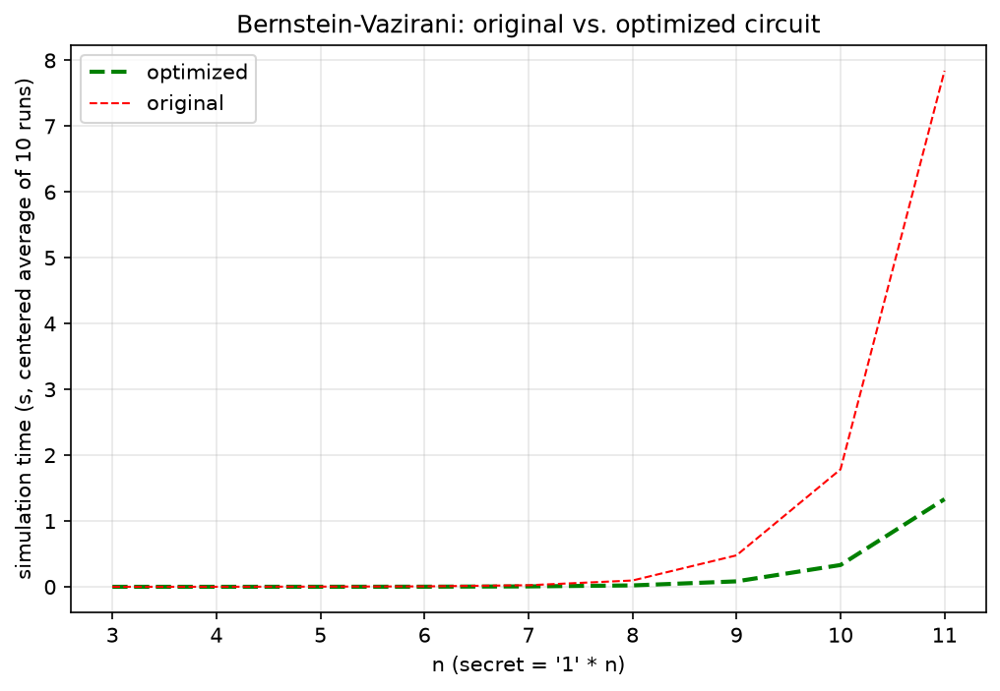

# bv-optimizer

A small quantum-compilation pipeline for the
[Bernstein–Vazirani algorithm](https://en.wikipedia.org/wiki/Bernstein%E2%80%93Vazirani_algorithm),
written in Python with [Cirq](https://github.com/quantumlib/Cirq):

1. **Compile.** Build a Bernstein–Vazirani circuit for any secret bit string `a`.
2. **Optimize.** Shrink the circuit with four gate-level rewrite templates.
3. **Export.** Lower the circuit to a JSON-style gate list using only `h`, `t` and `cx`.
4. **Simulate.** Run the exported program on a state-vector simulator written from scratch in NumPy.
5. **Benchmark.** Compare simulation time of the original and optimized circuits for n = 3…11.

On the all-ones secret, the optimizer reduces the circuit to **4 operations and depth 3 for every n**.
At n = 11 the optimized circuit simulates **about 6× faster** than the original.

## Background

Bernstein–Vazirani finds a hidden n-bit string `a` from an oracle `f(x) = a·x mod 2` in a
**single** query, where a classical algorithm needs n queries. The circuit is:

- Hadamard on every input qubit.
- `X` then `H` on the target qubit, which puts it in |−⟩.
- One CNOT from input `i` to the target for each bit `a_i = 1` (the oracle).
- Hadamard on every input qubit again, then measure. The result is exactly `a`.

```
bernstein_vazirani(3, "111")

qubit[0]: ───H───────@───H───────────M('result')───
                     │               │
qubit[1]: ───H───────┼───@───H───────M─────────────
                     │   │           │
qubit[2]: ───H───────┼───┼───@───H───M─────────────
                     │   │   │
target: ─────X───H───X───X───X─────────────────────
```

## The four rewrite templates

`optimize_bv` applies four templates in sequence ([`bv_optimizer/templates.py`](bv_optimizer/templates.py)).
Each template scans the gate sequence on every qubit and rewrites matching patterns.

**Template 1: `H Z H → X`**

```
──H──Z──H──   ≡   ──X──
```

This rule is the identity HZH = X. It is part of the pipeline for generality but does not fire
on Bernstein–Vazirani circuits, which contain no Z gates.

**Template 2: `H H → I`**

```
──H──H──   ≡   ─────
```

Hadamard is self-inverse, so two adjacent Hadamards on the same qubit cancel. In the Bernstein–Vazirani
circuit this removes the `H H` pairs on input qubits whose secret bit is 0.

**Template 3: reverse the CNOT direction**

```
──H──@──H──        ──X──
     │        ≡        │
──H──X──H──        ──@──
```

Conjugating a CNOT with Hadamards on both qubits swaps its control and target. The optimizer
matches `H · CNOT · H` on each input qubit, replaces it with a CNOT controlled by the target, and
moves the target's Hadamards to a single `H` at the end. The target is now in |1⟩ and acts as
control, so it flips exactly the input qubits where `a_i = 1`.

**Template 4: merge CNOTs that share a control**

```
──@──@──@──        ──@──
  │  │  │            │
──X──┼──┼──        ──X──
     │  │     ≡      │
─────X──┼──        ──X──
        │            │
────────X──        ──X──
```

Consecutive CNOTs with the same control and different targets are merged into one controlled
multi-target X (one control, several targets; this is not a Toffoli gate). The merged gate is
built as `cirq.ParallelGate(cirq.X, k).on(*targets).controlled_by(control)`.

### Result

```
optimize_bv(3, bernstein_vazirani(3, "111"))

qubit[0]: ───────X───M('result')───
                 │   │
qubit[1]: ───────X───M─────────────
                 │   │
qubit[2]: ───────X───M─────────────
                 │
target: ─────X───@───H─────────────
```

| n  | depth before → after | operations before → after | exported gates before → after |
|----|----------------------|---------------------------|-------------------------------|
| 3  | 7 → 3                | 12 → 4                    | 16 → 8                        |
| 7  | 11 → 3               | 24 → 4                    | 28 → 8                        |
| 11 | 15 → 3               | 36 → 4                    | 40 → 8                        |

## Export format

`export_circuit` produces a gate list for the simulator, using only `h`, `t` and `cx`:

```python
[
  {"gate": "h",  "qubits": [3]},
  {"gate": "t",  "qubits": [3]},
  ...
  {"gate": "cx", "qubits": [3, 0, 1, 2]},   # control first, then all targets
  {"gate": "h",  "qubits": [3]},
]
```

Gates outside this set are decomposed:

- **Z** becomes `T T T T`, since T⁴ = Z.
- **X** becomes `H T T T T H`, since H Z H = X.
- **Multi-target CX** from template 4 is exported as a single `cx` entry, control first.

## Simulator

[`bv_optimizer/simulator.py`](bv_optimizer/simulator.py) is a dense state-vector simulator:

- Single-qubit gates are expanded to the full 2ⁿ × 2ⁿ operator with Kronecker products (`I ⊗ … ⊗ U ⊗ … ⊗ I`).
- Controlled gates are built as `P0 ⊗ I … + P1 ⊗ X …`, which works for any number of targets.
- `get_counts` samples measurement outcomes from the |amplitude|² distribution.

## Benchmark

`benchmark.py` simulates both circuits for n = 3…11 with secret `'1' * n`. It reports the
centered average of 10 runs (fastest and slowest run dropped).



| n  | original | optimized | speedup |
|----|----------|-----------|---------|
| 3  | 0.6 ms   | 0.3 ms    | 2.1×    |
| 5  | 3.2 ms   | 1.1 ms    | 2.9×    |
| 7  | 24 ms    | 6.4 ms    | 3.8×    |
| 9  | 478 ms   | 83 ms     | 5.8×    |
| 11 | 7.84 s   | 1.33 s    | 5.9×    |

Absolute times depend on the machine. These were measured with Python 3.14 and NumPy 2.5 on Windows 11.

## Getting started

```bash
python -m venv .venv
# Windows: .venv\Scripts\activate    macOS/Linux: source .venv/bin/activate
pip install -r requirements.txt
```

Run the tests:

```bash
pytest
```

Run the benchmark (about 2 minutes, writes `benchmark.png`):

```bash
python benchmark.py
```

Use it from Python:

```python
from bv_optimizer import bernstein_vazirani, optimize_bv, export_circuit, run_program, get_counts

circuit = bernstein_vazirani(5, "10110")
optimized = optimize_bv(5, circuit)
print(optimized)

counts = get_counts(run_program(export_circuit(optimized)), 1000)
print(counts)   # first 5 bits are always "10110"; the last bit is the target qubit
```

## Project structure

```
bv-optimizer/
├── bv_optimizer/
│   ├── circuit.py      # bernstein_vazirani(n, a)
│   ├── templates.py    # gate_pos + template1–4
│   ├── optimizer.py    # optimize_bv(n, circuit)
│   ├── export.py       # export_circuit(circuit)
│   └── simulator.py    # state-vector simulator: run_program, get_counts
├── tests/
│   └── test_bv.py      # pytest suite
├── benchmark.py        # timing benchmark and plot
├── benchmark.png
├── requirements.txt
└── pyproject.toml
```

## Tests

`tests/test_bv.py` checks that:

- The original circuit measures the secret, on both Cirq's simulator and the custom simulator.
- The optimized circuit still measures the secret, on both simulators.
- Optimization always reduces the operation count and never increases depth.
- Exporting the optimized `"111"` circuit gives exactly 4 T gates.
- Exporting the optimized `"00111"` circuit gives a single `cx`, acting on 4 qubits.

## Scope

The optimizer targets Bernstein–Vazirani circuits specifically. The templates are applied in a
fixed order rather than through a general search heuristic. The simulator builds dense
2ⁿ × 2ⁿ operators, so memory and time grow exponentially. That is fine up to about 12 qubits,
and it makes the benefit of a smaller circuit easy to see.
